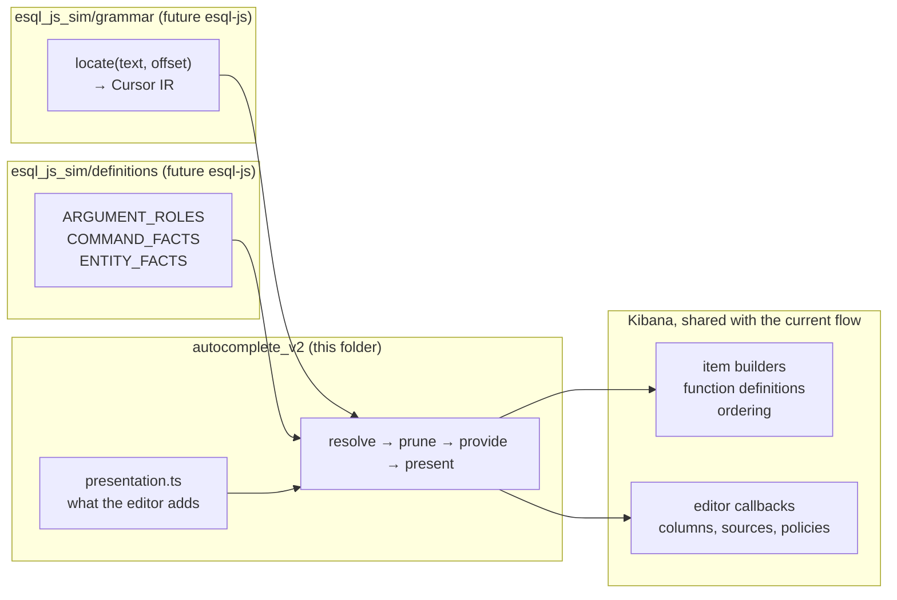
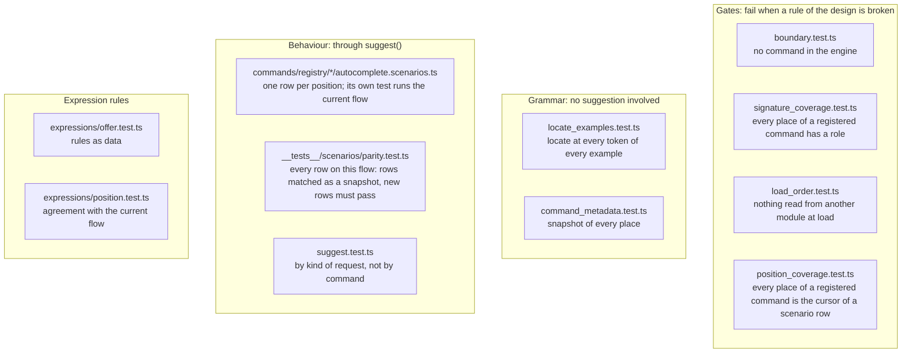

# Autocomplete v2

The grammar-driven autocomplete engine. It is built next to the current flow
(`../autocomplete`) and exports a `suggest` with the same signature; `../index.ts` exports one
of the two, so switching flows is one line.

**The engine knows no command.** A command gets its suggestions from where the cursor is in
the grammar and from a few lines of data that say what each argument means.

- [Who owns what](#who-owns-what)
- [I want to change something](#i-want-to-change-something)
- [Add a command](#add-a-command)
- [How one call runs](#how-one-call-runs)
- [Expressions](#expressions)
- [The order of the list](#the-order-of-the-list)
- [Tests](#tests)
- [Words](#words)

## Who owns what



| Part | Says | Kind |
|---|---|---|
| `esql_js_sim/grammar` | **Where** the cursor is, from the grammar alone | Code, no command named |
| `esql_js_sim/definitions` | **What** each argument means in the language | Data, per command |
| `presentation.ts` | **How** the editor shows a place beyond the language: common values, snippets, suggested names | Data, per place |
| The rest of this folder | The engine: one provider per kind of thing | Code, no command named |

Three rules keep it that way (`boundary.test.ts`):

- No import from a command's folder under `commands/registry/`.
- No command name and no grammar rule of a command (`whereCommand`) as a string in the engine.
- A provider written by hand for one argument is listed in `overrides.ts`, with an owner and
  an issue. The list is empty.

## I want to change something

| I want to… | Edit | Kind |
|---|---|---|
| Say what an argument of a command is (a column, a new name, an expression…) | `esql_js_sim/definitions/signatures/argument_roles.ts` | Data |
| Say what Elasticsearch requires and the grammar leaves open (an argument is needed, a clause is used once, a place is not supported yet) | `esql_js_sim/definitions/signatures/command_facts.ts` | Data |
| Offer common values where any value is valid (`LIMIT 10`) | `presentation.ts` → `getSuggestedValues` | Data |
| Offer a name for a new column | `presentation.ts` → `SUGGESTED_NAMES` | Data |
| Offer a ready-made string, selected once inserted | `presentation.ts` → `getValuePlaceholders` | Data |
| Offer values for one setting or option, or describe an option | `presentation.ts` → `getSuggestedValuesByName`, `getOptionDetails` | Data |
| Choose the parameter a map opens with | `presentation.ts` → `OPENING_PARAMETERS` | Data |
| Offer recommended queries after the sources | `presentation.ts` → `RECOMMENDED_QUERIES` | Data |
| Add a kind of entity (something named outside the query) | `esql_js_sim/definitions/entities/entity_facts.ts`, then `entities/registry.ts` in this folder | Data + one fetcher |
| Add a kind of role | `esql_js_sim/definitions/signatures/types.ts`, `validate_roles.ts`, then `providers/index.ts` | Schema + one provider |
| Change how a keyword, a separator or a bracket is offered | `providers/tokens.ts` | Code, by what the grammar allows next |
| Change which functions apply to a kind of expression | `expressions/functions.ts` | Code |
| Change what is offered at a position inside an expression | `expressions/offer.ts`, `expressions/operator_forms.ts` | Code, returns data |
| Change the order of the list | `../autocomplete/utils/sorting/priority_provider.ts` | Data, shared with the current flow |
| Change which text an item replaces | `present.ts` | Code |
| State or change the expected behaviour | `commands/registry/<command>/autocomplete.scenarios.ts` | Data |
| Follow a grammar upgrade | See [After a grammar upgrade](#after-a-grammar-upgrade) | Generated |

If a change needs a command's name in the engine, it belongs in one of the data files above.

## Add a command

The example is `CHANGE_POINT value ON key AS type, pvalue BY grouping`, as it is described
today.

**0. Before anything is written.** Once the grammar has the command it already works: its
keywords, its separators, the pipe, columns where the grammar takes a name, constants where it
takes a literal, scalar expressions where it takes one. These come from the grammar and from
`DEFAULT_ROLES`.

**1. Register it.** Write `commands/registry/<command>/index.ts` (name, description,
declaration, examples) and add the command to `baseCommands` in `commands/registry/index.ts`.
The `name` has to be the text of the command's first token: that is how the engine finds the
registered command for a grammar rule (`getRegisteredCommand`). Until the current flow is
removed, the registry type also asks for an `autocomplete` method of that flow; a command only
the new flow knows returns nothing there.

**2. Describe its arguments.** Remove the command from `UNDESCRIBED_COMMANDS`
(`command_facts.ts`) if it is listed there. `signature_coverage.test.ts` now fails and prints
the path of every place of the command that has no role. To see the places beforehand, filter
`getGrammarPositions()` by the command's rule. Add one line per place to `ARGUMENT_ROLES`:

```ts
'changePointCommand.value':             { kind: 'column', types: NUMBER_TYPES },
'changePointCommand.key':               { kind: 'column' },
'changePointCommand.targetType':        { kind: 'new_name', of: 'column' },
'changePointCommand.targetPvalue':      { kind: 'new_name', of: 'column' },
'changePointCommand.booleanExpression': { kind: 'expression', mode: 'key', unique: true },
```

The key of each line is a call site:

```
 grammar:   renameClause : oldName=qualifiedNamePattern AS newName=qualifiedNamePattern
                           ───────                         ───────
 call site:                renameClause.oldName            renameClause.newName
                           rule . label   (the grammar labels the call)

 grammar:   keepCommand  : KEEP qualifiedNamePatterns
                                ─────────────────────
 call site:                keepCommand>qualifiedNamePatterns
                           rule > called rule   (no label)
```

A role applies to everything below its call site that has no role of its own. So put it on
the outermost call site that means one thing: one line on a list covers each item, one line on
a value covers every kind of literal the grammar takes there.

The fields of each role are in `signatures/types.ts`. The file has shorthands for the common
ones: `columnList` (columns, each listed once), `newColumn`, `stringColumn`.

**3. Add facts**, only if Elasticsearch asks for more than the grammar does
(`COMMAND_FACTS`): `requiresArgument`, `requires`, `singleUse`, `unsupported`, `notInItself`,
`readsOwnColumns`.

**4. Add presentation**, only if the editor should offer more than the language says. An
entry has the same key as the role line:

```ts
// presentation.ts, SUGGESTED_NAMES
'changePointCommand.targetType':   'changePointType',
'changePointCommand.targetPvalue': 'pValue',
```

**5. Write the scenarios** in `commands/registry/<command>/autocomplete.scenarios.ts`: one row
per position, with the query and the items expected there, and next to it a three-line
`autocomplete.scenarios.test.ts` that calls `describeScenarios(table)`. A command only the new
flow knows has every row tagged `new`: those rows are checked by
`__tests__/scenarios/parity.test.ts`. See `__tests__/scenarios/README.md`.

`position_coverage.test.ts` fails until every place of the command is the cursor of a row.

**6. Update the snapshots** that list what is registered: `command_metadata.test.ts` and
`parity.test.ts` (run each with `-u` and read the diff). A test that names the command as not
adopted yet fails and is fixed by hand.

That is all for a typical command: an `index.ts`, five lines of roles, two lines of
presentation, a table of scenarios. No engine file changes.

```sh
node scripts/jest src/platform/packages/shared/esql/kbn-esql-language/src/language/autocomplete_v2
node scripts/jest src/platform/packages/shared/esql/kbn-esql-language/src/commands/registry/<command>
```

### After a grammar upgrade

| Step | What |
|---|---|
| Regenerate the labels | `node src/platform/packages/shared/esql/kbn-esql-language/scripts/generate_grammar_labels.js` from the Kibana root, then `node scripts/eslint --fix` on the generated file |
| `command_metadata.test.ts` snapshot changes | It lists every place of the registered commands: the diff is what the upgrade added, removed or renamed |
| `signatures.test.ts` fails | A role points at a call site that is gone or renamed: fix the key |
| `signature_coverage.test.ts` fails | A registered command has a new place: add its role |
| A command Kibana has not adopted | Add it to `UNDESCRIBED_COMMANDS` with the reason |

## How one call runs

```
 text, offset
      │
      ▼
 ┌─────────┐ Cursor IR ┌─────────┐ requests ┌───────┐ requests ┌─────────┐ items ┌─────────┐
 │ locate  │ ────────▶ │ resolve │ ───────▶ │ prune │ ───────▶ │ provide │ ────▶ │ present │ ─▶ list
 └─────────┘           └─────────┘          └───────┘          └─────────┘       └─────────┘
```

| Step | File | What it does |
|---|---|---|
| Locate | `esql_js_sim/grammar` | Where the cursor is in the grammar: the Cursor IR |
| Resolve | `resolve.ts` | What has to be offered there, as requests. Pure: nothing is fetched |
| Prune | `prune.ts` | Drops the requests the written text rules out, one named rule each |
| Provide | `providers/index.ts` | The items for each request, by its kind. Only this step talks to the editor |
| Present | `present.ts` | Each item once, the text it replaces, its place in the list |

`suggest.ts` is the whole flow in about fifty lines; `collect.ts` runs locate to provide for
one cursor. Three things go around that path:

| Case | File |
|---|---|
| Right after the character that starts a control, only controls are offered | `providers/controls.ts` |
| A command that ends with a text in another language (PROMQL): its options are read from the tokens, its text is served by that language's grammar | `option_shell.ts`, `providers/sublanguage.ts`, `promql/position.ts` |
| The word at the cursor is already whole: the flow is asked again one space later and each continuation is offered with the word | `whole_word.ts` |

A request is one of five kinds, each with one provider:

| Request | Provider | Example |
|---|---|---|
| `command_names` | `providers/command_names.ts` | `FROM a \| ▮` |
| `token` | `providers/tokens.ts` | `ASC`, `, `, `\| `, `NULLS FIRST` |
| `end_of_command` | `providers/tokens.ts` | The next line |
| `argument`, by its role | `providers/arguments.ts` (column, new name, constant), `providers/entities.ts`, `providers/structured.ts` (map, option name, dependent value) | `KEEP ▮`, `ENRICH ▮`, `WITH { ▮` |
| `expression`, by its role | `providers/expressions.ts` | `WHERE ▮` |

### Example: `FROM a | KEEP keywordField, ▮`

| Step | Result |
|---|---|
| Locate | `position: start_of_argument`, `previous: ,` (separator). One argument expected, on the path `keepCommand>qualifiedNamePatterns` / `qualifiedNamePatterns>qualifiedNamePattern`. Written: `KEEP`, `keywordField`, `,` |
| Resolve | One request: an argument with the role `{ kind: 'column', wildcard: 'pattern', unique: true }`, found at `keepCommand>qualifiedNamePatterns` |
| Prune | Nothing dropped |
| Provide | The column provider asks for the columns of `FROM a` (fetched now, not before). `unique` leaves out `keywordField`. An item of a list gets no trailing space |
| Present | Every column of `a` but `keywordField` |

### Example: `FROM a | SORT keywordField ▮`

| Step | Result |
|---|---|
| Locate | `position: after_argument`. Followers: the operators of an expression, `nulls`, `asc`, `desc` (keywords), `,` (separator), `\|` (pipe), the end |
| Resolve | Seven requests: one expression (`mode: 'scalar'`), three keyword tokens, the separator, the pipe, the end of the command |
| Prune | Nothing dropped: `keywordField` is a whole expression |
| Provide | Expression: the operators that take a keyword. Keywords, by what the grammar allows after each: `ASC`, `DESC` alone; `NULLS` joined with what has to follow, `NULLS FIRST`, `NULLS LAST`. Then `, `, `\| ` and the next line |
| Present | 15 items, keywords first |

At `FROM a | WHERE doubleField > ▮` the prune step matters: the expression is not a whole
boolean yet, so the pipe and the end of the command are dropped until it is.

## Expressions

An expression is one request, whatever the cursor is nested in. Its provider runs four steps,
one file each in `expressions/`:

```
 Cursor IR ─▶ position.ts ─▶ environment.ts ─▶ offer.ts ─▶ build.ts ─▶ items
              where in the    the types of      the rule:   the items
              expression      what is written   an Offer    of an Offer
                                                (data)
```

| Step | File | What it does |
|---|---|---|
| Position | `position.ts` | Where the cursor is inside the expression, from the grammar alone: the start of an operand, after an operand, after an operator, after `NOT` or a cast, in a string or a map, and the function call and argument it is in |
| Types | `environment.ts` | The types of what is written and what the functions written take. With `tree.ts`, the only reader of the syntax tree |
| Offer | `offer.ts`, `operator_forms.ts` | The rule for the position. It returns data and builds no item |
| Build | `build.ts` | The items of an offer. The only file that uses the item builders the commands share |

`FROM a | WHERE doubleField > ▮` gives the position `after_operator`, the left type `double`,
and the offer:

```ts
{ operands: { types: ['double', 'integer', 'long', …], columns: true, literals: 'exact' } }
```

Next to these: `functions.ts` (which functions apply, from the mode of the role), `columns.ts`
(the names an expression reads beyond the columns of the query), `names.ts` (the names a
grouping defines) and `lambdas.ts`.

**Lambdas** (`v -> v > 1`). The grammar allows one as any argument of any function; which
argument takes one is a fact of the function (`FUNCTION_LAMBDAS`, empty until a function
declares one, tested with simulated functions). Where that argument starts, the parameters
with the arrow are offered; in the body, the parameters in scope are offered next to the
columns.

**Shared with the current flow, on purpose:** the item builders, the function definitions, and
the type of a written expression (the grammar gives the range, the syntax tree gives the type).
The current flow's expression engine (`suggestForExpression`) is not used
(`expressions/no_old_engine.test.ts`).

**Different from the current flow, on purpose:**

- After a keyword of the command typed in full (`SORT a ASC`), nothing of the expression is
  offered.
- Inside an open string, nothing is offered, except the editor's suggestions for a KQL query.
- Right after `NOT` at the start of a function argument, boolean operands are offered.
- A list in brackets that no operator comes before, as `WHERE (a, b) `, gets nothing.

## The order of the list

```
 item ─▶ its category ─▶ base priority ─▶ adjusted for the command ─▶ ties by label ─▶ sortText
         (set by the      (CATEGORY_       and the clause
          provider, or     PRIORITIES)     (CONTEXT_BOOSTS)
          inferred)
```

`present.ts` hands the items to the ordering engine the current flow uses
(`../autocomplete/utils/sorting`), with the registered name of the command and the last keyword
written in it as the clause. Lower comes first: actions, keywords, the next line and the pipe,
columns, operators, functions.

Known limit: the adjustments are keyed by the current flow's own names for places
(`Location`), not by call site.

## Tests



| I changed… | Run |
|---|---|
| A role, a fact or `presentation.ts` | `__tests__/scenarios/parity.test.ts` (it runs the scenario rows on this flow), `signature_coverage.test.ts` |
| The engine | This folder and `__tests__/scenarios` |
| An expression rule | `expressions/` |
| The grammar version | Everything under `esql_js_sim` and this folder |

A scenario row is written for either flow. Today a command's own scenario test runs the
current flow only, and `parity.test.ts` runs every table on this flow. A behaviour changed on
purpose has two rows: one tagged `replaced` (what the current flow does) and one tagged `new`
(what this flow does, which has to pass). Parity counts the untagged rows.

## Words

| Word | Meaning |
|---|---|
| Cursor IR | The result of `locate(text, offset)`: a description of the cursor with the same shape for every command |
| Position | One of a closed set: the start of the query, of a statement, of a command or of an argument, inside an argument, after an argument, inside a string, inside a comment, invalid |
| Call site | One place in the grammar where a rule takes a rule or a token: `rule.label` or `rule>called`. The identity of an argument, and the key of every table of data |
| Path | The call sites from the command down to an argument. Roles are looked up along it |
| Place | A call site with the offset it starts at: one written thing that contains others, as one function call. `open` while the cursor is inside it |
| Expected argument | An argument the grammar allows at the cursor |
| Written argument | An argument or a token already written in the command, with its call site, text, range and the places it is in. It replaces reading the syntax tree |
| Follower | A token the grammar allows next, with its class: `keyword`, `operator`, `separator`, `opener`, `closer`, `pipe`, `terminator`, `value`, `end` |
| Word | What is being typed at the cursor, and whether it is already a whole token |
| Role | What an argument means in the language. One of `column`, `new_name`, `entity`, `constant`, `option_name`, `map`, `expression`, `dependent_value`, `parameter`, `sublanguage` |
| Signature | The roles of one command, keyed by call site |
| Default role | The role an argument gets with no signature, from its grammar rule |
| Mode | The kind of expression a role asks for: scalar, aggregation, grouping, key, filter, constant, full text. It decides which functions apply |
| Request | What `resolve` asks for at the cursor |
| Provider | The function that makes the items of one kind of request or role |
| Context | What a provider knows besides its request: the IR, the columns of the query before the cursor, the editor's callbacks, the license |
| Entity | A named thing outside the query: a source, an enrich policy, a lookup index, an inference endpoint, a setting, a metadata field |
| Scope | What narrows the entities at the cursor: the index mode, the parent's name, inside a subquery, serverless |
| Offer | What an expression rule returns: which operands, which operators, whether the comma |
| Follow-up | What is offered on a word that is already whole: the word with what can come after it |
| Scenario row | One query with a cursor and the items expected there |
| Parity | The number of scenario rows on which this flow gives what the current flow gives |
